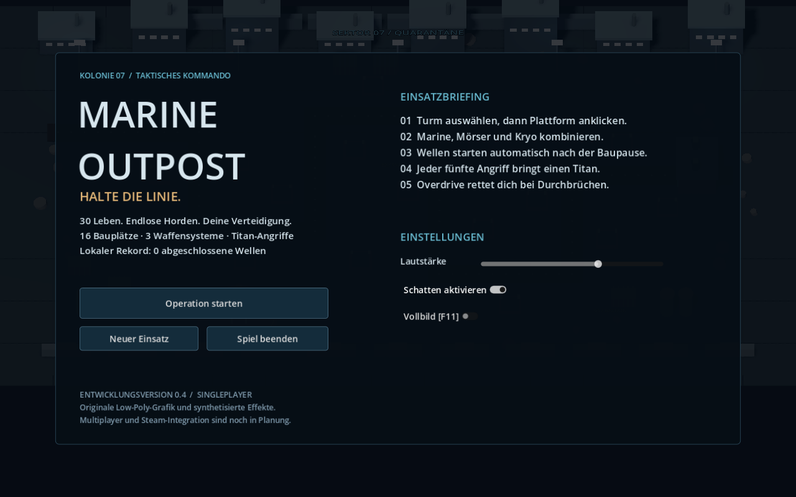
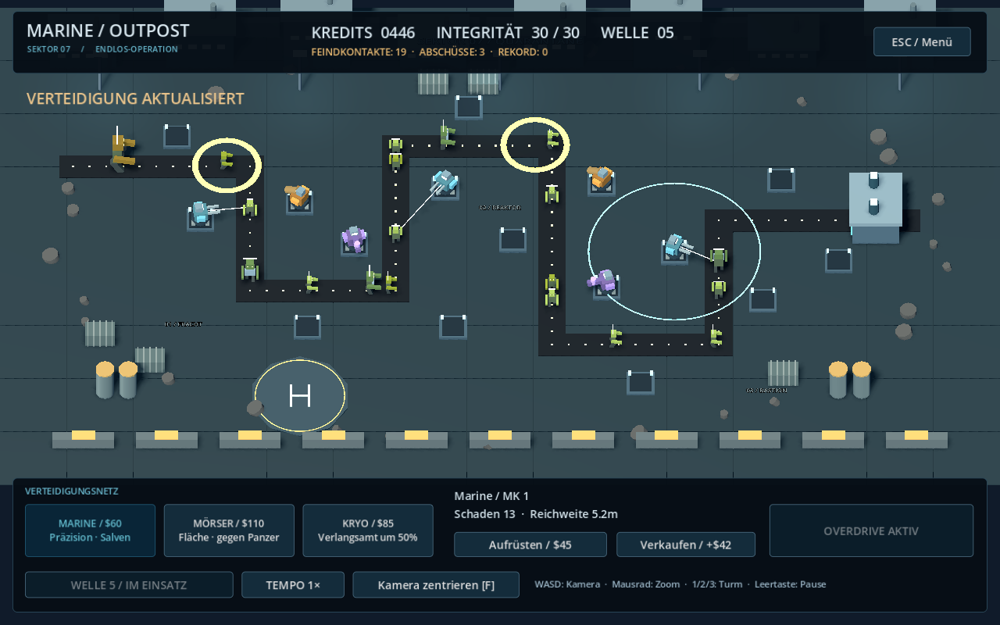

# Marine Outpost — 0.4

Ein Sci-Fi-Tower-Defense-Prototyp für Windows mit Godot 4.6. Das Spiel startet in 3D; die ursprüngliche 2D-Szene bleibt unter `game/main.tscn` erhalten.

## Start

ZIP entpacken, `project.godot` in Godot 4.6 importieren und **F5** drücken. Im Hauptmenü **Operation starten** wählen. Keine zusätzlichen Assets oder Plugins nötig.

## Neu in 0.4

- Größere Kolonie und längere Route mit **16 Bauplätzen**.
- Neues Kommando-HUD, Haupt-/Pausenmenü, Einsatzbriefing und Ergebnisansicht.
- Gespeicherte Lautstärke- und Schatteneinstellungen, Vollbild über F11.
- **Overdrive**: acht Sekunden doppelte Feuerrate, 45 Sekunden Abklingzeit.
- Sechs originale synthetisierte Effekte für Waffen, Bauen, Angriffe und Alarme.
- Detailliertere Marine-Stellungen, Koloniegebäude, Landeplatz, Beleuchtung und Trefferfunken.
- Wiederverwendete Effekt-Meshes statt laufender Neuerzeugung.




## Steuerung

| Aktion | Eingabe |
| --- | --- |
| Turm wählen | 1 / 2 / 3 oder Turmkarte |
| Bauen / Turm auswählen | Linksklick auf Plattform / Turm |
| Kamera bewegen | WASD |
| Zoom | Mausrad |
| Kamera zurücksetzen | F |
| Overdrive | Q oder Schaltfläche |
| Pause / Menü | Leertaste / Escape |
| Vollbild | F11 |

Marine kostet $60, Mörser $110 und Kryo $85. Mörser treffen mehrere Gegner und ignorieren Rüstung. Kryo halbiert die Bewegung für 2,5 Sekunden. Verkauf erstattet 70 % der Investition.

Die erste Welle startet nach zwölf Sekunden; nach jeder abgewehrten Welle folgen acht Sekunden Baupause. Sprinter kommen ab Welle 2, Panzer ab Welle 3, Titans in jeder fünften Welle. Normale Durchbrüche kosten ein Leben, Titans fünf. Du startest mit 30 Leben. Der lokale Rekord zählt abgeschlossene Wellen. Pause stoppt auch Countdown und Fähigkeiten.

## Validierung

```sh
godot --headless --path . --script res://game/smoke_test.gd
godot --headless --path . --script res://game/smoke_3d.gd
```

Tests schreiben lokale Rekorde. Verwende für Tests separate `XDG_DATA_HOME`, `XDG_CONFIG_HOME` und `XDG_CACHE_HOME`, insbesondere bei schreibgeschütztem Cloud-Home.

Gameplay und 3D-Integration werden automatisch geprüft. Der Build wurde außerdem mit echter OpenGL-Darstellung unter Linux geprüft; Windows-Leistung und Soundqualität brauchen eigene Spieltests.

Das ist noch kein fertiges 15-€-Spiel. Siehe [Qualitätsziel und fehlende Release-Bausteine](docs/RELEASE_TARGET.md) sowie [Roadmap](docs/ROADMAP.md). Multiplayer, Steam-Integration, permanente Forschung und Speichern eines laufenden Einsatzes sind noch nicht implementiert.
