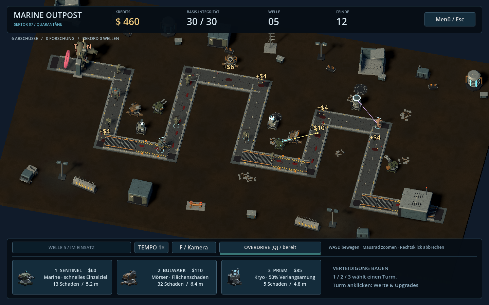

# Marine Outpost — 0.9

Sci-Fi-Tower-Defense für Windows in Godot 4.6. Spielbarer Entwicklungsstand mit freiem Turmbau, zufälligen Routen und Forschung zwischen Einsätzen.

## Start

ZIP in einen neuen Ordner entpacken, `project.godot` in Godot 4.6 importieren und **F5** drücken. Im Hauptmenü **Operation starten** wählen.

## Neu in 0.9

Diese Version konzentriert sich auf **Türme, Monster und Bedienung**.

- **Alle neun Turmmodelle überarbeitet:** unterschiedliche Panzerfarben, kantige Standfüße, Stabilisatoren, Kühlkörper, Optiken und Kryo-Kondensatoren. Schüsse zeigen Mündungslicht und Waffenrückstoß, die Gatling dreht sich.
- **Alle vier Gegner überarbeitet:** zusammenhängende Brustkörbe, kleinere Schädel, freiliegende Rippen, Sehnen und beschädigte Rüstung. Separate Knie und Unterarme ergänzen die Laufbewegung; Hetzer und Titan haben eigene Bewegungstempi. Trefferfeedback, kameraseitige Lebensbalken und Frostmarkierungen zeigen den Kampfzustand.
- **Kompakteres HUD:** getrennte Anzeigen für Geld, Leben, Welle und Feinde; ein gemeinsames Bedienfeld statt zweier großer Leisten.
- **Kontextansicht beim Turmklick:** passendes Modellportrait auch für Spezialisierungen, Upgrade mit Vorher-/Nachher-Schaden und Feuerrate, Hinweis auf fehlende Credits, Zielwahl und Verkauf.
- **Einfacher bauen:** Hover-Ring, Auswahl des nächstgelegenen Turms, Mehrfachbau mit **Shift + Linksklick** und weiterhin erreichbare Vorschau bei zu wenig Geld. Mausaktionen über dem HUD bauen keine Türme.
- **Modellgalerie:** zusätzliche Ansichten für Türme **[T]** und Monster **[M]**. Insgesamt weiterhin 32 Assets.



[Turmauswahl und Upgrade-Vorschau](docs/previews/v0.9.0/inspector.png) · [Nahansicht](docs/previews/v0.9.0/closeup.png) · [Neun Türme](docs/previews/v0.9.0/towers.png) · [Vier Monster](docs/previews/v0.9.0/monsters.png) · [Screenshot-Ablauf](docs/PREVIEWS.md)

Das Menü **Modellgalerie / 32 Assets** zeigt alle Modelle einzeln mit Zoom und als Übersicht. [Asset-Liste und Blender-Quelle](models/README.md).

## Aus Version 0.6

- **Frei platzieren:** keine vorgegebenen Bauplätze, kein Raster. Straßen, Rand und andere Türme bleiben frei. Vorschau mit Reichweite, gültiger/ungültiger Farbe und Begründung.
- **Zufällige Lane pro neuem Einsatz.** Der Seed wird mitgespeichert, die Route ändert sich nicht während eines laufenden Runs.
- **Kontext-UI:** Baukarten beim Bauen; beim Turmklick wechseln sie zu Werten, Upgrades, Spezialisierungen, Zielwahl und Verkauf. Rechtsklick oder Esc hebt die Auswahl auf.
- **Credits springen hoch:** Jeder Abschuss zeigt eine animierte goldene Münze und den tatsächlichen Betrag über dem Gegner.
- Neuer Boden mit prozeduraler Struktur, beleuchtete Straßenränder, weniger Schilder, runde Zombie-Körper und neue Turmsockel. Kulissen stehen außerhalb des Baugebiets.


## Steuerung

| Aktion | Eingabe |
| --- | --- |
| Turm zum Bauen wählen | 1 / 2 / 3 oder Baukarte |
| Frei platzieren | Linksklick neben der Straße |
| Mehrere Türme bauen | Shift + Linksklick; Rechtsklick beendet den Baumodus |
| Turm auswählen | Linksklick auf Turm |
| Bau/Selektion abbrechen | Rechtsklick / Esc |
| Kamera bewegen / zentrieren | WASD / F |
| Zoom | Mausrad |
| Overdrive | Q |
| Pause / Menü | Leertaste; Esc ohne aktive Auswahl |
| Manuell speichern | F5 im laufenden Spiel oder Menü |
| Vollbild | F11 |

Marine $60, Mörser $110, Kryo $85. Ab MK 3 stehen pro Turm zwei Spezialisierungen zur Wahl. Verkauf erstattet 70 % der Investition. Höchstens 80 Türme pro Einsatz.

Wellen starten automatisch nach zwölf Sekunden Vorbereitung und acht Sekunden Baupause. Sprinter ab Welle 2, Panzer ab Welle 3, Titan alle fünf Wellen. Du hast 30 Leben; Titans kosten bei Durchbruch fünf. Overdrive verdoppelt die Feuerrate acht Sekunden lang.

## Fortschritt und Spielstände

Forschung, Spezialisierungen und Zielprioritäten aus [Version 0.5](docs/VERSION_0_5.md) bleiben erhalten. Autosave alle 20 Sekunden außerhalb der Pause und nach abgewehrten Wellen. Beim nächsten Start **Spielstand fortsetzen** wählen.

Seit 0.6 werden freie Koordinaten und der Karten-Seed in **`run_v2.json`** gespeichert. Spielstände aus 0.6–0.8 sind mit 0.9 kompatibel. Die alten festen Run-Spielstände aus 0.5 (`run_v1.json`) sind nicht kompatibel und werden nicht verändert. **Forschung, Rekorde und Einstellungen bleiben erhalten.** Details: [Version 0.6](docs/VERSION_0_6.md).

## Tests

```sh
godot --headless --path . --script res://game/smoke_test.gd
godot --headless --path . --script res://game/smoke_3d.gd
godot --headless --path . --script res://game/smoke_progression.gd
godot --headless --path . --script res://game/smoke_maps.gd
godot --headless --path . --script res://game/smoke_models.gd
```

Tests schreiben Nutzerdaten. Verwende separate `XDG_DATA_HOME`, `XDG_CONFIG_HOME` und `XDG_CACHE_HOME`. Die Grafik wird zusätzlich mit OpenGL unter Linux geprüft; Windows-Leistung und Audio benötigen eigene Spieltests. Screenshots zeigen arrangierte Situationen im tatsächlichen Build.

Multiplayer und Steam-Anbindung fehlen noch. Siehe [Roadmap](docs/ROADMAP.md) und [Release-Qualitätsziel](docs/RELEASE_TARGET.md). Der alte 2D-Prototyp bleibt als separate Szene `game/main.tscn` erhalten.
